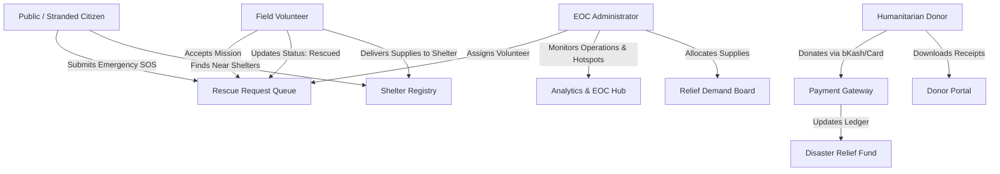

<div align="center">

  

  # Durjog Sheba (দুর্যোগ সেবা)
  ### Nationwide Emergency Disaster Relief, Rescue Logistics & Humanitarian Donation Platform

  <p align="center">
    <strong>একটি সমন্বিত জাতীয় দুর্যোগ সাড়াদান, জরুরি উদ্ধার কার্যক্রম, আশ্রয়কেন্দ্র নেটওয়ার্ক ও স্বচ্ছ ত্রাণ অনুদান প্ল্যাটফর্ম</strong>
  </p>

  <p align="center">
    <a href="#-key-features">Key Features</a> •
    <a href="#-demo-credentials">Demo Access</a> •
    <a href="#-role-based-workflows">User Roles</a> •
    <a href="#-tech-stack">Tech Stack</a> •
    <a href="#-project-structure">Architecture</a> •
    <a href="#-getting-started">Installation</a>
  </p>

  <p align="center">
    
    
    
    
    
    
    
    
  </p>

</div>

---

## 📌 Project Overview (প্রজেক্ট পরিচিতি)

**Durjog Sheba (দুর্যোগ সেবা)** is an enterprise-grade humanitarian disaster management web application tailored for Bangladesh's recurrent flood, cyclone, and river-erosion crises. It bridges the critical communication gap between stranded victims, voluntary rescue workers, registered shelters, and generous donors.

Built on modern **Next.js 16 (App Router + Turbopack)** and **React 19**, the platform delivers real-time situational awareness, verified financial transactions, interactive analytical graphs, and streamlined disaster logistics.

---

## 🚀 Key Features (মূল বৈশিষ্ট্যসমূহ)

### 🚨 1. Emergency SOS & Rescue Operations
- **Real-Time Distress Broadcast**: Victims or relatives can submit emergency rescue appeals with GPS coordinates/location, trapped headcount, contact phone, and urgency level.
- **Urgency Priority Queue**: Automatic sorting and visual severity indicators (`CRITICAL`, `HIGH`, `MEDIUM`, `LOW`).
- **Complete Ticket Lifecycle**: Tracks operations from `PENDING` $\rightarrow$ `ASSIGNED` $\rightarrow$ `IN_PROGRESS` $\rightarrow$ `RESCUED` $\rightarrow$ `CANCELLED`.
- **Field Volunteer Dispatch**: Admins can assign verified volunteers to specific rescue tickets directly from the command center.

### 📊 2. Executive Command & Control (EOC) Dashboard
- **Real-Time Live Sync**: Centralized command overview powered by real backend database queries (`/admin`).
- **4 Key Performance Indicators (KPIs)**:
  - **Total Community Users** (active field volunteers, registered donors, and admins).
  - **Emergency Rescues** (total tickets, pending queue, and overall rescue success rate %).
  - **Shelter Network Capacity** (occupied beds vs total national emergency bed capacity).
  - **Disaster Relief Funds** (real-time verified BDT funds raised and average donation size).
- **Interactive Visualizations (Recharts)**:
  - Area chart for chronologically cumulative and daily donation inflows.
  - Bar chart showing operational status of rescue missions.
  - Geographical hotspot analysis ranking the most disaster-affected regions.
  - Shelter occupancy vs available bed capacity gauges.
- **Live Incident Feeds**: Instant view of the 5 newest emergency distress calls and latest donor contributions.

### 📈 3. Disaster Intelligence & Analytics Hub (`/admin/analytics`)
- **Period Range Filters**: Analyze data across `Last 7 Days`, `Last 30 Days`, or `All Time`.
- **One-Click Printable Reports**: Built-in `window.print()` formatted PDF reporting for government bodies and relief organizations.
- **Humanitarian Supply Fulfillment Matrix**: Compares requested vs fulfilled relief units across item categories (Food, Clean Water, Medicine, Hygiene, Clothing).
- **Regional Operations Audit Table**: Granular district-level audit detailing total distress calls, stranded people, critical cases, pending rescues, and rescue completion rates.

### 🏕️ 4. Shelter Network & Evacuation Management
- **Interactive Shelter Directory**: Public and volunteer lookup of registered disaster shelters by District and Upazila.
- **Live Bed Availability**: Real-time occupancy percentage to prevent overcrowded facilities during floods and cyclones.
- **Coordinator Directory**: Instant contact access to shelter focal persons and physical addresses.

### 📦 5. Humanitarian Relief Logistics
- **Shelter-Based Supply Appeals**: Shelters post concrete demands with unit quantities (KG, Liter, Packet, Piece, Box).
- **Fulfillment Tracking**: Admins and volunteers update delivery quantities in real-time to avoid duplicate donations.

### 💳 6. Digital Donation & Transparent Ledger
- **Payment Gateway Integration**: Multi-gateway support (bKash, SSLCommerz, Nagad, Card).
- **Donor History & Receipts**: Donors can track every contribution, view transaction IDs, and generate official printable tax/donation receipts.
- **Strictly Non-Dummy Data**: 100% connected to live backend payment callbacks and audit logs.

### 🔐 7. Multi-Role RBAC & 1-Click Demo Access
- **Role-Based Access Control**: Strict client-side and server-side route guards for `ADMIN`, `VOLUNTEER`, and `DONOR`.
- **Instant Demo Logins**: Pre-configured SaaS-styled 1-click test buttons for evaluators.
- **Google OAuth 2.0**: Seamless social authentication.

---

## ⚡ 1-Click Demo Credentials (ডেমো লগইন)

For testing and evaluation, you can log in instantly using the demo buttons on the `/login` page or use the credentials below:

| Role | Email | Password | Primary Dashboard | Key Capabilities |
| :--- | :--- | :--- | :--- | :--- |
| 🛡️ **Admin** | `admin@durjogsheba.com` | `Admin@123456` | `/admin` | EOC Command, Analytics, Volunteer Dispatch, Shelters, User Audits |
| 🛟 **Volunteer** | `volunteer@durjogsheba.com` | `Volunteer@123456` | `/volunteer` | Task Acceptance, Rescue Field Updates, Nearby Shelter Finder |
| ❤️ **Donor** | `donor@durjogsheba.com` | `Donor@123456` | `/donor` | Online Donations (BDT), Payment History, Official Tax Receipts |

---

## 👥 Role-Based Workflows (ব্যবহারকারীর ভূমিকা ও কাজের ধারা)



---

## 🛠️ Tech Stack & Architecture (ব্যবহৃত প্রযুক্তি)

| Layer | Technologies |
| :--- | :--- |
| **Framework** | **Next.js 16.4.3** (App Router, Turbopack, React Server Components) |
| **Library** | **React 19.3.0** |
| **Language** | **TypeScript 5.0** (Strict Type Checking, Zero `any`) |
| **Styling** | **Tailwind CSS 4.0**, `@tailwindcss/turbopack`, `tw-animate-css` |
| **UI Components** | Radix UI / Base UI, Lucide Icons, Custom Design System |
| **Data Fetching & Cache** | **TanStack React Query v5**, `ofetch` HTTP client |
| **Data Visualizations** | **Recharts 3.10** (Area Charts, Bar Charts, Donut Charts, Gauges) |
| **Form Management** | TanStack React Form, Zod Validation |
| **Authentication** | JWT Bearer Tokens, HTTP Cookies, `@react-oauth/google` |
| **Code Quality** | **Biome 2.4** (Strict Formatting & Fast Linting) |

---

## 📁 Project Structure (প্রজেক্ট কাঠামো)

```text
durjog-sheba-frontend/
├── public/                     # Static assets, branding, and images
│   ├── Logo.png               # Durjog Sheba official emblem
│   └── images/                # Emergency hero and visual assets
├── src/
│   ├── api/                   # Typed API service layer (ofetch client)
│   │   ├── admin.api.ts       # Admin dashboard & stats endpoints
│   │   ├── auth.api.ts        # Authentication & verification APIs
│   │   ├── donation.api.ts    # Payment and donation transaction APIs
│   │   ├── rescue.api.ts      # Emergency rescue CRUD & dispatch APIs
│   │   ├── reliefNeed.api.ts  # Relief demand & allocation APIs
│   │   ├── shelters.api.ts    # Shelter directory & occupancy APIs
│   │   └── users.api.ts       # User management APIs
│   ├── app/                   # Next.js App Router (Nested Route Groups)
│   │   ├── (dashboard)/       # Role-protected dashboard layouts
│   │   │   ├── admin/         # Command Overview, Analytics, Rescues, Shelters
│   │   │   ├── volunteer/     # Available Tasks, My Tasks, Nearby Shelters
│   │   │   └── donor/         # Donate, Transaction Ledger, Tax Receipts
│   │   ├── (public)/          # Landing page, About, Shelters, Rescue Feed
│   │   │   └── (auth)/        # Login (1-click demos), Register, Password Reset
│   │   └── payment/           # Payment gateway callbacks (/success, /failed)
│   ├── components/            # Reusable UI component modules
│   │   ├── admin/             # Modular Recharts visualizations & management modals
│   │   │   └── charts/        # DonationTrend, RescueStatus, Hotspots, ShelterCapacity
│   │   ├── auth/              # RoleGuard, AuthCard, OAuth buttons
│   │   ├── dashboard/         # DashboardShell, Sidebar, Header, User Menu
│   │   ├── donation/          # DonationCheckoutCard, DonationTable, ReceiptModal
│   │   └── ui/                # Buttons, Cards, Inputs, Modals, Skeletons
│   ├── hooks/                 # React Query mutation & query hooks
│   ├── routes/                # Centralized sidebar route definitions per role
│   ├── types/                 # Pure TypeScript domain interfaces & API contracts
│   └── lib/                   # API client configuration and utility functions
├── .env.example               # Environment variables template
├── biome.json                 # Biome linting and formatting configuration
├── package.json               # NPM dependencies and project scripts
└── tsconfig.json              # TypeScript strict configuration
```

---

## 💻 Getting Started (ইনস্টলেশন ও রান নির্দেশিকা)

### 1. Prerequisites
- **Node.js**: `v20.x` or higher (LTS recommended)
- **Package Manager**: `npm` (v10+), `pnpm`, or `yarn`

### 2. Clone the Repository
```bash
git clone https://github.com/sabbirtanvir13/DurjogSheba_Frontend.git
cd DurjogSheba_Frontend
```

### 3. Install Dependencies
```bash
npm install
```

### 4. Configure Environment Variables
Copy `.env.example` to `.env.local`:
```bash
cp .env.example .env.local
```

Ensure `.env.local` is configured with the backend API endpoint:
```env
# Backend API URL
NEXT_PUBLIC_API_URL=https://durjog-sheba-backend.vercel.app/api/v1

# Google OAuth Client ID (Optional for local testing)
NEXT_PUBLIC_GOOGLE_CLIENT_ID=your-google-client-id.apps.googleusercontent.com
```

### 5. Run Development Server
```bash
npm run dev
```

Open [http://localhost:3000](http://localhost:3000) in your browser to view the application.

---

## 📜 Available Scripts (কমান্ডসমূহ)

| Command | Description |
| :--- | :--- |
| `npm run dev` | Starts the Next.js development server with Turbopack |
| `npm run build` | Compiles the production build with strict type-checking |
| `npm run start` | Runs the compiled production build |
| `npm run lint` | Runs Biome code quality analysis |
| `npm run format` | Auto-formats the entire codebase with Biome |

---

## 🔒 Code Quality & Verification (কোড কোয়ালিটি)

This project strictly adheres to:
- **Zero Dummy Data Policy**: Every single chart, table, card, and counter is populated from real backend API endpoints.
- **Strict TypeScript Validation**: Fully passes `npx tsc --noEmit` with zero errors.
- **Modern Next.js 16 Standards**: Proper `<Suspense>` boundaries around query params, client components, and image optimizations.
- **Biome Linter & Formatter**: Clean, consistent, and lightning-fast code checks.

---

## 🤝 Contributing (অবদান)

Contributions to improve Bangladesh's disaster resilience and emergency relief operations are welcome!

1. Fork the Project
2. Create your Feature Branch (`git checkout -b feature/AmazingFeature`)
3. Commit your Changes (`git commit -m 'feat: Add some AmazingFeature'`)
4. Push to the Branch (`git push origin feature/AmazingFeature`)
5. Open a Pull Request

---

## 📄 License

Distributed under the **MIT License**. See `LICENSE` for more information.

---

<div align="center">
  <p><strong>দুর্যোগ সেবা — মানুষের পাশে, সংকট উত্তরণে একতাবদ্ধ।</strong></p>
  <p>Dedicated to supporting flood and disaster-affected communities across Bangladesh.</p>
</div>
